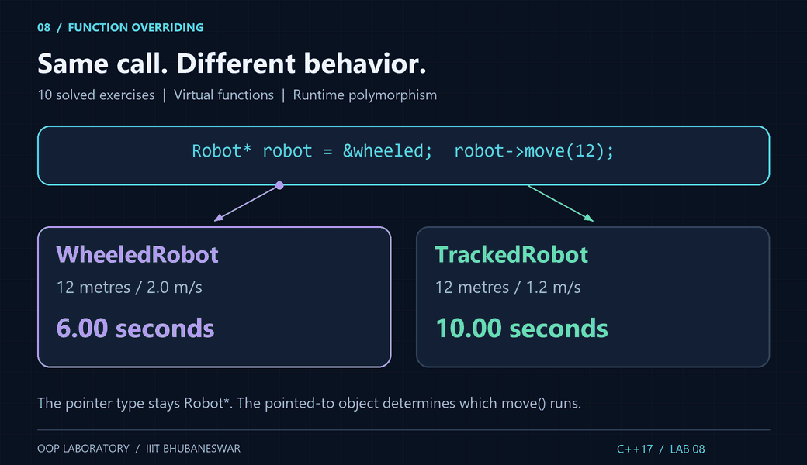
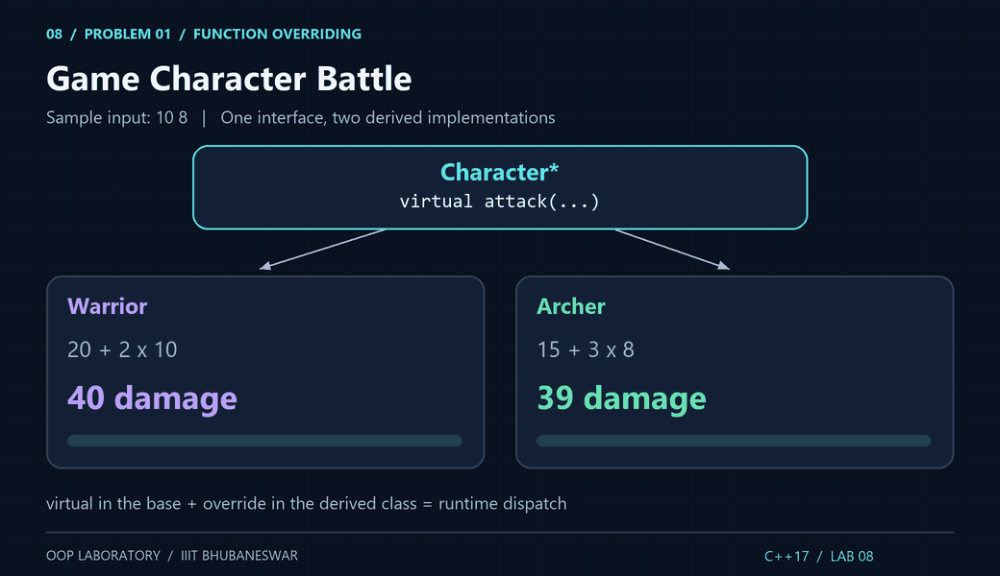
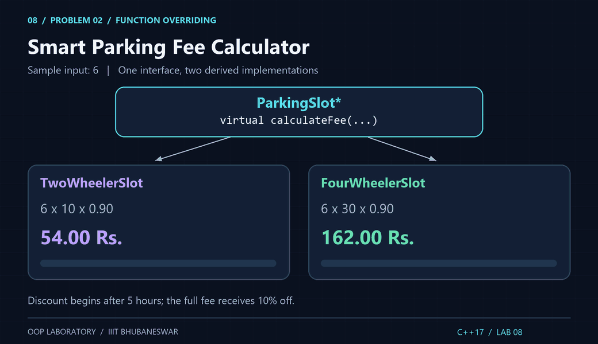
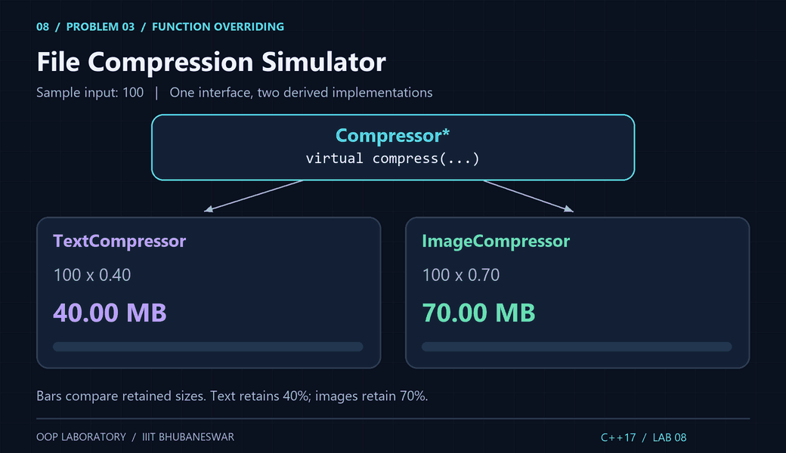
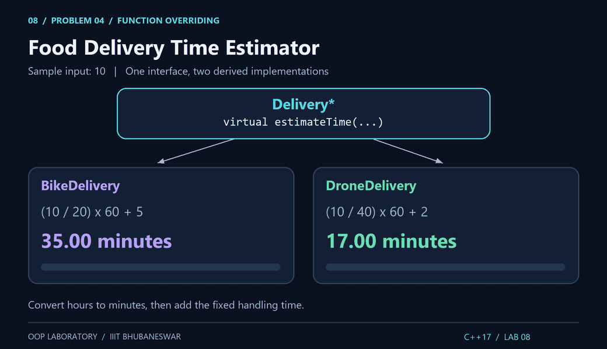
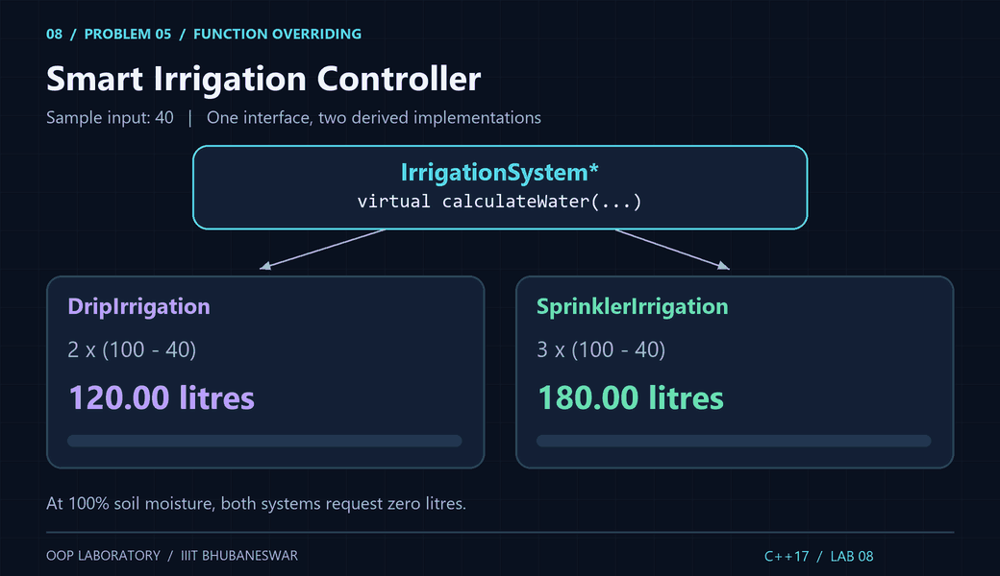
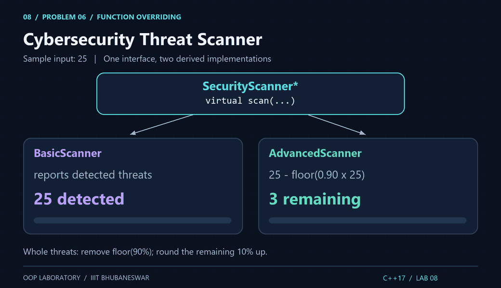
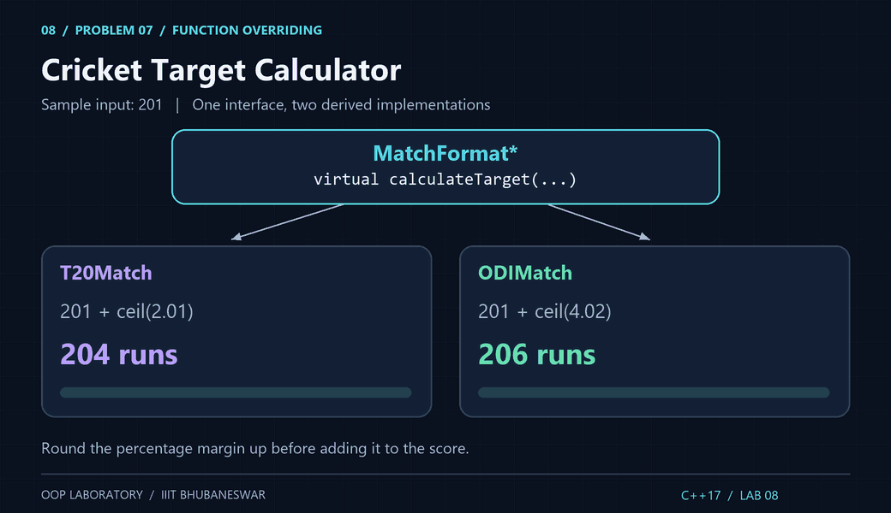
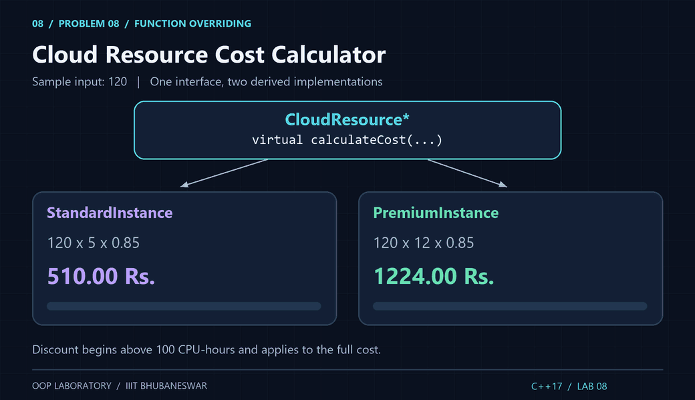
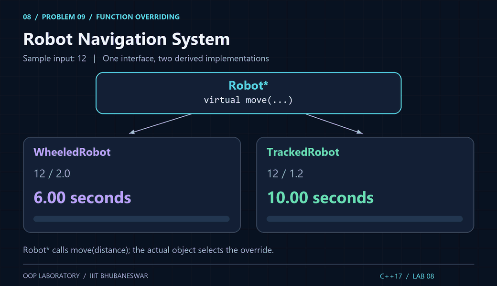

<div align="center">

# Lab 8 · Function Overriding

**C++17 · 10 exercises · Group B2 · 27 October 2026**

IIIT Bhubaneswar · B.Tech 3rd Semester · OOP Laboratory

<picture>
  <source media="(prefers-reduced-motion: reduce)" srcset="../assets/lab8_overriding_preview.png">
  
</picture>

[Repository home](../README.md) · [Previous: Lab 7](../LAB%207/) · [Sample files](./samples/)

</div>

Ten standalone solutions to the **Lab 8: Function Overriding, Group B2** worksheet dated **27.10.2026**. Each source includes `#include <iostream>` and `using namespace std;`, with the required base/derived classes, matching signatures, virtual functions and `override`. All ten demonstrate calls through base-class pointers, including the explicitly required demonstrations in P9 and P10.

## Exercise index

| # | Exercise | Base function | Source | Sample input |
|:---:|:---|:---|:---:|:---|
| 1 | [Game Character Battle](#p1) | `Character::attack()` | [L8P1.cpp](./L8P1.cpp) | `10 8` |
| 2 | [Smart Parking Fee Calculator](#p2) | `ParkingSlot::calculateFee(int hours)` | [L8P2.cpp](./L8P2.cpp) | `6` |
| 3 | [File Compression Simulator](#p3) | `Compressor::compress(double fileSize)` | [L8P3.cpp](./L8P3.cpp) | `100` |
| 4 | [Food Delivery Time Estimator](#p4) | `Delivery::estimateTime(double distance)` | [L8P4.cpp](./L8P4.cpp) | `10` |
| 5 | [Smart Irrigation Controller](#p5) | `IrrigationSystem::calculateWater(double moisture)` | [L8P5.cpp](./L8P5.cpp) | `40` |
| 6 | [Cybersecurity Threat Scanner](#p6) | `SecurityScanner::scan(int threats)` | [L8P6.cpp](./L8P6.cpp) | `25` |
| 7 | [Cricket Target Calculator](#p7) | `MatchFormat::calculateTarget(int firstInningsScore)` | [L8P7.cpp](./L8P7.cpp) | `201` |
| 8 | [Cloud Resource Cost Calculator](#p8) | `CloudResource::calculateCost(double cpuHours)` | [L8P8.cpp](./L8P8.cpp) | `120` |
| 9 | [Robot Navigation System](#p9) | `Robot::move(double distance)` | [L8P9.cpp](./L8P9.cpp) | `12` |
| 10 | [AI Recommendation Engine](#p10) | `Recommender::generateRecommendation(int userRating, int popularity)` | [L8P10.cpp](./L8P10.cpp) | `80 60` |

## Compile and run

Each file defines its own `main()`. Compile one source into one executable. From this folder:

```bash
g++ -std=c++17 -Wall -Wextra -pedantic L8P1.cpp -o L8P1
./L8P1
```

Windows PowerShell:

```powershell
g++ -std=c++17 -Wall -Wextra -pedantic L8P1.cpp -o L8P1.exe
if ($LASTEXITCODE -ne 0) { throw "Compilation failed" }
.\L8P1.exe
```

Enter `10 8` on one line: the warrior deals **40** damage and the archer deals **39**. Replace `P1` with `P2`–`P10` for the other programs. P1 and P10 take two values; all others take one. Press Enter after the values. The same input is compared across both derived implementations.

Each program validates the entire input line, rejects trailing junk and missing values, and returns a nonzero status for invalid data. Integer inputs must fit an `int`; quantities must be finite and non-negative. Moisture and recommendation inputs must be within 0–100. P4 and P8 also check for arithmetic overflow. Decimal results use two places; damage, threats and cricket targets use integers.

## The common algorithm

1. Read and validate the input.
2. Construct the two derived objects and assign their addresses to base-class pointers.
3. Invoke the matching virtual function through each pointer.
4. Let the derived override apply its formula, then display the result with units.

```cpp
class Robot {
public:
    virtual ~Robot() = default;
    virtual double move(double distance) = 0;
};

// WheeledRobot and TrackedRobot each override move(double).
// These are stack objects; the pointers do not own them.
WheeledRobot wheeled;
TrackedRobot tracked;
Robot* first = &wheeled;
Robot* second = &tracked;
cout << first->move(12);   // 6 seconds
cout << second->move(12);  // 10 seconds
```

`= 0` makes the base class abstract; it cannot be constructed directly. `override` asks the compiler to verify the signature. The virtual destructor supports safe polymorphic destruction. Runtime dispatch depends on the object's actual type. Passing objects by base value would slice off the derived part; pointers avoid that.

## Solutions, sample runs and animations

Samples below show input separately from output. The linked `.out.txt` files are captured from execution with redirected input, so they include prompts without terminal input echo. The GIFs illustrate the formulas and dispatch; they are explanatory diagrams rather than terminal recordings. Their bars compare the final values in each panel, with units stated explicitly.

<a id="p1"></a>

### 1. Game Character Battle

**Classes:** `Character` → `Warrior` / `Archer`.

**Calculation:** Warrior: 20 + 2 * strength; Archer: 15 + 3 * agility.

The attributes are supplied to the constructors because attack() has no parameters. Use long long arithmetic to avoid overflow for valid int attributes.

[Source](./L8P1.cpp) · [Sample input](./samples/L8P1.in.txt) · [Captured output](./samples/L8P1.out.txt)

Input:

```text
10 8
```

Result:

```text
Warrior damage: 40
Archer damage: 39
```

<picture>
  <source media="(prefers-reduced-motion: reduce)" srcset="../assets/lab8_p01_preview.png">
  
</picture>

<a id="p2"></a>

### 2. Smart Parking Fee Calculator

**Classes:** `ParkingSlot` → `TwoWheelerSlot` / `FourWheelerSlot`.

**Calculation:** Base fee = hours * rate. Rates: Rs. 10/h and Rs. 30/h. Multiply the entire fee by 0.90 only when hours > 5.

Exactly 5 hours has no discount. The same duration is used for both vehicle types so their rates can be compared.

[Source](./L8P2.cpp) · [Sample input](./samples/L8P2.in.txt) · [Captured output](./samples/L8P2.out.txt)

Input:

```text
6
```

Result:

```text
Two-wheeler fee: Rs. 54.00
Four-wheeler fee: Rs. 162.00
```

<picture>
  <source media="(prefers-reduced-motion: reduce)" srcset="../assets/lab8_p02_preview.png">
  
</picture>

<a id="p3"></a>

### 3. File Compression Simulator

**Classes:** `Compressor` → `TextCompressor` / `ImageCompressor`.

**Calculation:** Text retains 0.40 * original; image retains 0.70 * original.

These percentages are the retained sizes, not the reductions. This simulates sizes; it does not compress an actual file.

[Source](./L8P3.cpp) · [Sample input](./samples/L8P3.in.txt) · [Captured output](./samples/L8P3.out.txt)

Input:

```text
100
```

Result:

```text
Original size: 100.00 MB
Text compressed size: 40.00 MB
Image compressed size: 70.00 MB
```

<picture>
  <source media="(prefers-reduced-motion: reduce)" srcset="../assets/lab8_p03_preview.png">
  
</picture>

<a id="p4"></a>

### 4. Food Delivery Time Estimator

**Classes:** `Delivery` → `BikeDelivery` / `DroneDelivery`.

**Calculation:** Bike: (distance / 20) * 60 + 5 minutes; drone: (distance / 40) * 60 + 2 minutes.

Convert travel hours into minutes before adding the fixed overhead. Even a zero-distance request includes the stated overhead.

[Source](./L8P4.cpp) · [Sample input](./samples/L8P4.in.txt) · [Captured output](./samples/L8P4.out.txt)

Input:

```text
10
```

Result:

```text
Bike delivery time: 35.00 minutes
Drone delivery time: 17.00 minutes
```

<picture>
  <source media="(prefers-reduced-motion: reduce)" srcset="../assets/lab8_p04_preview.png">
  
</picture>

<a id="p5"></a>

### 5. Smart Irrigation Controller

**Classes:** `IrrigationSystem` → `DripIrrigation` / `SprinklerIrrigation`.

**Calculation:** Drip: 2 * (100 - moisture); sprinkler: 3 * (100 - moisture) litres.

The allowed moisture range includes 0 and 100. At 100% both systems supply zero litres.

[Source](./L8P5.cpp) · [Sample input](./samples/L8P5.in.txt) · [Captured output](./samples/L8P5.out.txt)

Input:

```text
40
```

Result:

```text
Drip water: 120.00 litres
Sprinkler water: 180.00 litres
```

<picture>
  <source media="(prefers-reduced-motion: reduce)" srcset="../assets/lab8_p05_preview.png">
  
</picture>

<a id="p6"></a>

### 6. Cybersecurity Threat Scanner

**Classes:** `SecurityScanner` → `BasicScanner` / `AdvancedScanner`.

**Calculation:** Whole-threat convention: remaining = ceil(threats / 10); removed = threats - remaining.

The sheet does not specify rounding when 90% is fractional. This solution removes floor(0.9 * threats) whole threats and rounds the remainder up; for 25 it removes 22 and retains 3. For multiples of 10 it removes exactly 90%.

[Source](./L8P6.cpp) · [Sample input](./samples/L8P6.in.txt) · [Captured output](./samples/L8P6.out.txt)

Input:

```text
25
```

Result:

```text
Basic scanner detected: 25
Advanced scanner detected: 25
Advanced scanner removed: 22
Advanced scanner remaining: 3
```

<picture>
  <source media="(prefers-reduced-motion: reduce)" srcset="../assets/lab8_p06_preview.png">
  
</picture>

<a id="p7"></a>

### 7. Cricket Target Calculator

**Classes:** `MatchFormat` → `T20Match` / `ODIMatch`.

**Calculation:** T20 target = score + ceil(0.01 * score); ODI target = score + ceil(0.02 * score).

Round the percentage margin up, then add it to the score. No extra +1 is added: this is the worksheet formula. At score 0 the stated formula gives target 0. Integer arithmetic avoids floating-point rounding errors.

[Source](./L8P7.cpp) · [Sample input](./samples/L8P7.in.txt) · [Captured output](./samples/L8P7.out.txt)

Input:

```text
201
```

Result:

```text
T20 target: 204
ODI target: 206
```

<picture>
  <source media="(prefers-reduced-motion: reduce)" srcset="../assets/lab8_p07_preview.png">
  
</picture>

<a id="p8"></a>

### 8. Cloud Resource Cost Calculator

**Classes:** `CloudResource` → `StandardInstance` / `PremiumInstance`.

**Calculation:** Rates: Rs. 5 and Rs. 12 per CPU-hour. If cpuHours > 100, multiply the total by 0.85.

Exactly 100 CPU-hours has no discount. Fractional CPU-hours are supported. The discount applies to all usage, not only the hours beyond 100.

[Source](./L8P8.cpp) · [Sample input](./samples/L8P8.in.txt) · [Captured output](./samples/L8P8.out.txt)

Input:

```text
120
```

Result:

```text
Standard cost: Rs. 510.00
Premium cost: Rs. 1224.00
```

<picture>
  <source media="(prefers-reduced-motion: reduce)" srcset="../assets/lab8_p08_preview.png">
  
</picture>

<a id="p9"></a>

### 9. Robot Navigation System

**Classes:** `Robot` → `WheeledRobot` / `TrackedRobot`.

**Calculation:** Time in seconds = distance in metres / speed in m/s. Speeds: 2.0 and 1.2 m/s.

The two Robot* pointers point to different derived objects. first->move(distance) and second->move(distance) call their respective overrides. No heap allocation is needed.

[Source](./L8P9.cpp) · [Sample input](./samples/L8P9.in.txt) · [Captured output](./samples/L8P9.out.txt)

Input:

```text
12
```

Result:

```text
Wheeled robot time: 6.00 seconds
Tracked robot time: 10.00 seconds
```

<picture>
  <source media="(prefers-reduced-motion: reduce)" srcset="../assets/lab8_p09_preview.png">
  
</picture>

<a id="p10"></a>

### 10. AI Recommendation Engine

**Classes:** `Recommender` → `PersonalizedRecommender` / `TrendingRecommender`.

**Calculation:** Personalized: 0.7 * userRating + 0.3 * popularity; trending: 0.3 * userRating + 0.7 * popularity.

Both integer inputs must be from 0 through 100. Decimal coefficients preserve fractional scores. Calls use Recommender* pointers as requested.

[Source](./L8P10.cpp) · [Sample input](./samples/L8P10.in.txt) · [Captured output](./samples/L8P10.out.txt)

Input:

```text
80 60
```

Result:

```text
Personalized score: 74.00
Trending score: 66.00
```

<picture>
  <source media="(prefers-reduced-motion: reduce)" srcset="../assets/lab8_p10_preview.png">
  
</picture>

## Check the solutions

From the repository root, with GCC and Python 3 installed:

```bash
python scripts/verify_lab8.py
```

The verifier compiles all ten files with `-std=c++17 -Wall -Wextra -Wpedantic -Werror`, compares captured samples, and performs **110 execution checks**. Cases include 5/6 parking hours, 100/100.5 CPU-hours, percentage ceiling, zero and fractional quantities, maximum integer values, malformed input, range rejection and floating-point overflow. It also inspects the virtual interfaces, two overrides per base, and both base pointers. Temporary executables are kept outside the repository.

## Viva quick notes

| Question | Answer |
|:---|:---|
| What is function overriding? | A derived class provides its own implementation of an inherited virtual function with the matching signature. |
| How does it differ from overloading? | Overloading uses different parameter lists; overriding replaces behavior along an inheritance hierarchy. |
| Why make the base function virtual? | Calls through a base pointer or reference can dispatch to the derived implementation at runtime. |
| What does `override` check? | That the function really overrides a virtual base function, catching signature mistakes. |
| What does `= 0` mean? | The function is pure virtual; the class is abstract. |
| Is a virtual function the same as virtual inheritance? | No. Virtual functions control dispatch; virtual inheritance shares a base subobject in a diamond. |
| Why use `double` for money and time here? | The lab uses fractional calculations; results are displayed to two decimals. |
| Why does P7 use integer ceiling arithmetic? | It rounds the required margin up exactly without floating-point errors. |
| Are the scanner percentages always exact whole counts? | No. This solution documents removal rounded down and remaining threats rounded up. |
| Must the derived objects be allocated with `new`? | No. Base pointers can refer to live stack objects. |

## Rebuild the visuals

```bash
python -m pip install Pillow
python scripts/generate_lab8_assets.py
```

Twelve looping GIFs include the Lab 8 overview, the eight-lab journey, and one comparison for each problem. Every GIF has a static PNG alternative for reduced-motion preferences. The diagrams use the same sample data as the programs. [Asset guide](../assets/README.md).

---

[← Lab 7](../LAB%207/) · [Repository home](../README.md) · [Lab Exam-1](../Lab%20Exam-1/)
